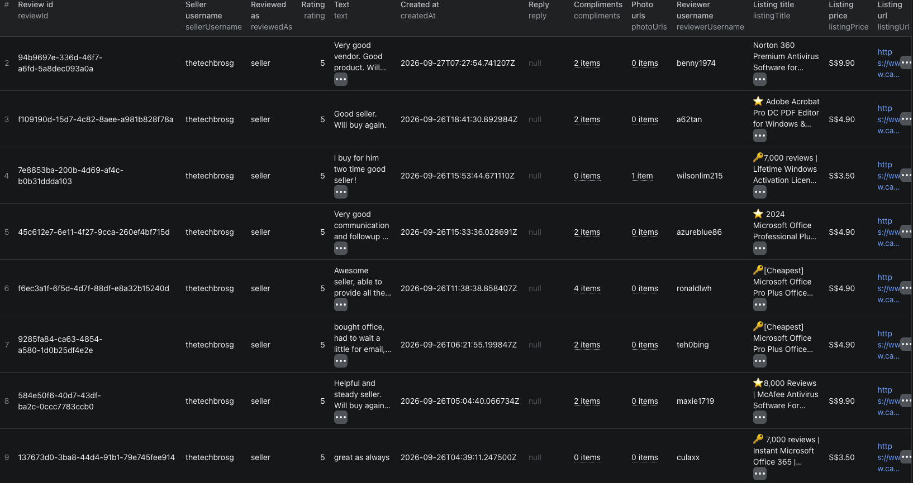

# How to Scrape Carousell Seller Reviews in Node.js

This example calls our Carousell Reviews Scraper on Apify. It does not implement a Carousell scraper from scratch.



The screenshot shows `thetechbrosg` from a separate run; the code below uses `litemobile.official`. The hero illustration is in [`images/carousell_reviews_blog.png`](./images/carousell_reviews_blog.png).

## What this example does

- Sends one Carousell seller profile URL
- Requests up to ten reviews received as a seller
- Waits for the Actor and fetches its dataset
- Prints the profile and review rows

Use a seller profile URL or username, not a listing URL. `maxReviewsPerSeller` is per seller. The profile row is separate from review rows, and residential proxy usage may be billed separately.

## Prerequisites

- Node.js 18 or later
- An Apify account and [API token](https://console.apify.com/settings/integrations)

## Installation

```bash
npm install
```

## Environment setup

Copy `.env.example` to `.env`, then replace the placeholder with your Apify token. Do not commit `.env`.

## Usage

```bash
npm start
```

## Code example

```js
import { ApifyClient } from 'apify-client';
import 'dotenv/config';

// Initialize the ApifyClient with your Apify API token
// Set APIFY_TOKEN in your .env file (copy .env.example to get started)
const client = new ApifyClient({
    token: process.env.APIFY_TOKEN,
});

// Prepare Actor input
const input = {
    "sellers": [
        "https://www.carousell.sg/u/litemobile.official/"
    ],
    "maxReviewsPerSeller": 10,
    "includeBuyerReviews": false,
    "proxyConfiguration": {
        "useApifyProxy": true,
        "apifyProxyGroups": [
            "RESIDENTIAL"
        ],
        "apifyProxyCountry": "SG"
    }
};

// Run the Actor and wait for it to finish
const run = await client.actor('piotrv1001/carousell-reviews-scraper').call(input);

// Fetch and print Actor results from the run's dataset (if any)
console.log('Results from dataset');
console.log(`💾 Check your data here: https://console.apify.com/storage/datasets/${run.defaultDatasetId}`);
const { items } = await client.dataset(run.defaultDatasetId).listItems();
items.forEach((item) => {
    console.dir(item);
});

// 📚 Want to learn more 📖? Go to → https://docs.apify.com/api/client/js/docs
```

## Example output

[`sample-output.json`](./sample-output.json) contains two abbreviated rows. These are abbreviated records from our September 27, 2026 Actor documentation, not a current result. Useful fields include `recordType`, `sellerUsername`, `reviewedAs`, `rating`, `text`, `createdAt`, `listingTitle`, and `listingPrice`.

## Use cases

- Review recent feedback before shortlisting a seller
- Distinguish seller feedback from feedback received as a buyer
- Inspect complaints alongside profile rating counts
- Track new reviews with `reviewedSince`

## Try the Actor on Apify

**[Open the Carousell Seller Reviews Scraper on Apify](https://apify.com/piotrv1001/carousell-reviews-scraper)**

## Related resources

- [Read the step-by-step guide](https://www.falconscrape.com/blog/how-to-vet-carousell-sellers-with-reviews)

## License

MIT
